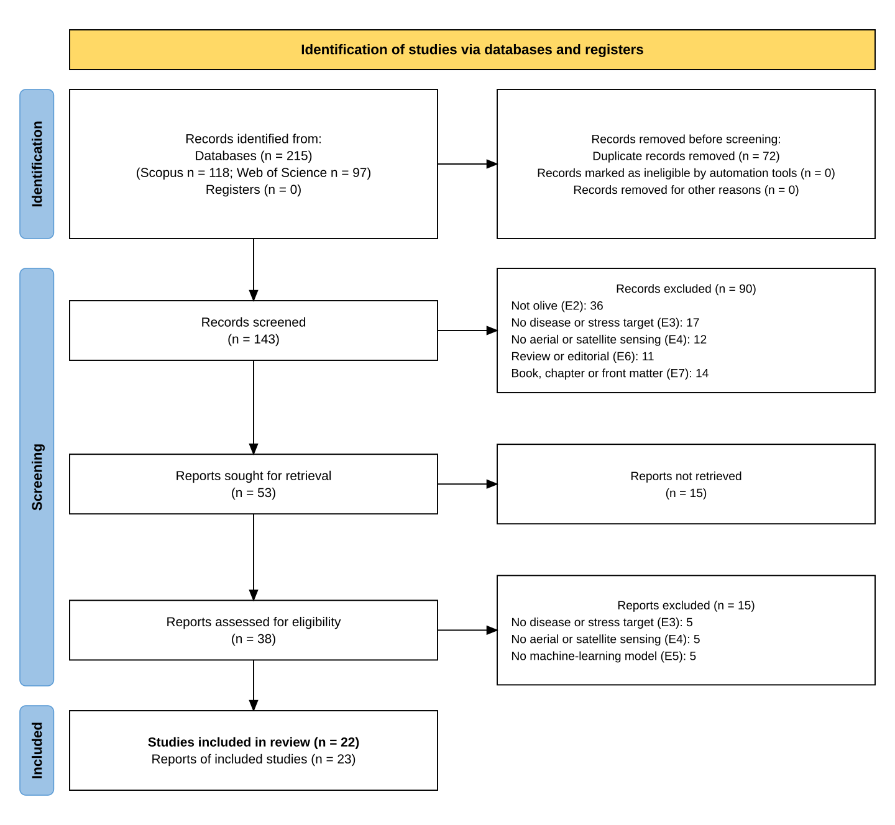

# Lab 7 — Construire le diagramme de flux PRISMA 2020

**Revue systématique :** *Machine learning and remote sensing for disease and stress detection in olive* (PRISMA 2020)
**Résultat :** 215 enregistrements identifiés → 72 doublons → 143 examinés → 90 exclus → 53 rapports recherchés → 15 non récupérés → 38 évalués → 15 exclus → **23 rapports, 22 études incluses**




## En bref

**Technologies.** **Python 3** (bibliothèque standard + openpyxl), **SQL standard** (`sql/prisma_verification.sql` pour le contrôle relationnel des tables et vues PRISMA) et un **classeur Excel avec de vraies formules** (`=SUM`, `=COUNTA`, `=COUNTIF`, `=COUNTIFS`, `=IF`, `=IFERROR`). Le diagramme est écrit en **SVG/PNG** et suit la structure du modèle officiel PRISMA 2020. Un fichier CSV est fourni au format du **modèle officiel** (package R PRISMA2020 / application en ligne), prêt à être importé.

**Aucun nombre n'est saisi à la main**, sauf les nombres de départ par base. Tous les autres sont recalculés à partir du tableau de tri de la revue (une ligne par enregistrement unique, avec sa décision), puis contrôlés deux fois : par les formules de l'énoncé et par un comptage indépendant.

**Correspondance étapes → fichiers**

| Étape du lab | Section | Fichiers |
|---|---|---|
| 1 Introduction | §1 | `README.md` |
| 2 Nombres d'identification | §2 | `data/identification.csv`, `output/01_identification.csv`, feuille **Identification** |
| 3 Records, reports, studies | §3 | `data/rapports_etudes.csv`, `output/02_records_reports_studies.csv`, feuille **Records_Reports_Studies** |
| 4 Tableau de vérification | §4 | `output/03_verification.csv`, feuille **Vérification** |
| 5 Après déduplication | §5 | feuille **Vérification** (B4 = B2 − B3) |
| 6 Screening titre/résumé | §6 | `output/04_exclusions_titre_resume.csv`, feuille **Motifs** |
| 7 Recherche des textes intégraux | §7 | feuille **Vérification** (B6 = B4 − B5) |
| 8 Textes non récupérés | §8 | feuille **Tri** (statut « Non récupéré ») |
| 9 Évaluation de l'éligibilité | §9 | feuille **Vérification** (B8 = B6 − B7) |
| 10 Exclusions avec motifs | §10 | `output/05_exclusions_texte_integral.csv`, feuille **Exclusions** (=COUNTA) |
| 11 Nombre final d'études | §11 | `output/06_controles.csv`, feuille **Vérification** (checklist), `scripts/prisma_flow.py` |
| 12 Diagramme avec l'outil officiel | §12 | `output/07_PRISMA_officiel.csv`, `output/08_prisma2020_flow.svg/.png` (+ version française `_fr`) |
| 13 Vérification et défis | §13 | `verifications.txt`, feuille **Défis**, `output/10_defi1_corrections.csv`, `output/11_defi2_prisma.png` |
| 14 Conclusion | §14 | `README.md` |

**Exécuter**

```bash
pip install -r requirements.txt
python scripts/prisma_flow.py                   # nombres, contrôles, CSV de l'outil officiel, diagramme SVG
python scripts/build_workbook.py                # classeur Excel (recalculé par LibreOffice s'il est installé)
python -m unittest discover -s tests -t . -v    # 20 tests (flux, classeur Excel et vérification SQL)
```

`prisma_flow.py` s'arrête avec une erreur si un seul contrôle échoue. La conversion SVG → PNG utilise `rsvg-convert` s'il est installé.

**Tests** (18) :
- `test_flux.py` : chaque nombre de la chaîne et chaque motif ; les 8 contrôles ; la distinction rapports/études ; un contrôle qui doit échouer quand on introduit une erreur ; le CSV de l'outil officiel (valeurs, même structure que le modèle) ; le contenu du SVG ; les 15 exclusions documentées ; les questions et les deux défis ;
- `test_classeur.py` : les 9 feuilles, la présence des formules de l'énoncé (`=B2-B3`, `=B4-B5`, `=SUM`, `=COUNTA`, `=IFERROR`), les valeurs et contrôles enregistrés, l'exemple de l'énoncé (1000 → 780 → 230 → 220 → 60), les corrections du défi 1.

## Contenu du dépôt

| Fichier | Rôle |
|---|---|
| `data/identification.csv` | Enregistrements par base (recherche du 15/11/2026, Lab 3) |
| `data/Screening_ledger_olive_PRISMA2020.csv` | Tableau de tri de la revue : 143 enregistrements uniques, décision et étape (Labs 5 et 6) |
| `data/rapports_etudes.csv` | Rapports qui décrivent la même étude |
| `data/commentaires_texte_integral.csv` | Motif final documenté dans le manuscrit, quand il diffère de la note du tableau de tri |
| `data/PRISMA_template_officiel.csv` | Modèle CSV de l'outil officiel (package R PRISMA2020, N. R. Haddaway, licence MIT) |
| `scripts/prisma_flow.py` | Calcul, contrôles, CSV officiel rempli, diagramme SVG/PNG, défis |
| `scripts/build_workbook.py` | Classeur Excel de vérification |
| `output/` | Sorties numérotées dans l'ordre du lab (voir le tableau ci-dessus) |
| `output/09_verification_prisma.xlsx` | Classeur : Identification, Vérification, Records_Reports_Studies, Tri, Exclusions, Liens_rapports_études, Motifs, Exemple_énoncé, Défis |
| `sql/prisma_verification.sql` | Script SQL complet (tables, vues `v_verification_prisma` / `v_controles_coherence`, Défi 1) |
| `verifications.txt` | Réponses aux 3 questions et aux 2 défis |
| `tests/` | 20 tests automatiques (flux Python, classeur Excel et requêtes SQL) |

---

## 1. Introduction et prérequis

Le diagramme PRISMA 2020 montre ce que deviennent les enregistrements à chaque étape de la sélection. Chaque nombre doit pouvoir être retracé jusqu'à sa source, et ce qui sort d'une case doit égaler ce qui entre dans la suivante. Ce lab construit le diagramme de la revue à partir des décisions réelles des Labs 3 à 6, et vérifie toute la chaîne de calcul.

**Choix des nombres.** Le Lab 5 a montré qu'une communication de conférence (Blekos et al., CEUR 2020) avait été fusionnée à tort avec l'article de revue de même titre (144 enregistrements uniques au lieu de 143), et le Lab 6 l'a laissée « en attente ». **À la demande de l'autrice, ce diagramme reprend les chiffres de la SLR telle que rédigée (143 enregistrements)**, dans lesquels la chaîne est cohérente à chaque étape. L'écart est une limite connue : si la référence est réintégrée, il y aura 71 doublons et 144 enregistrements examinés, et un rapport de plus rattaché à l'étude Blekos 2021 ; le nombre d'études restera 22.

## 2. Récupération des nombres d'identification

| Base | Champ | Date | Enregistrements |
|---|---|---|---:|
| Scopus | TITLE-ABS-KEY | 15/11/2026 | 118 |
| Web of Science Core Collection | TS | 15/11/2026 | 97 |
| **Total** | | | **215** (=SUM) |

Ces nombres viennent de la recherche documentée au Lab 3 et des exports bruts du Lab 5. Aucun registre, site web ni recherche de citations n'a été utilisé : les cases correspondantes du modèle officiel valent 0. Les bases IEEE Xplore et ACM DL de l'exemple de l'énoncé n'ont pas été interrogées dans cette revue. Leurs nombres (420, 310, 180, 90) sont repris dans la feuille **Exemple_énoncé** pour vérifier les formules.

## 3. Records, reports et studies

| Étape | Unité | Nombre | Définition |
|---|---|---:|---|
| Identification | records | 215 | notices brutes ; un article indexé dans les deux bases compte deux fois |
| Après déduplication | records | 143 | notices uniques soumises au tri titre/résumé |
| Recherche du texte intégral | reports | 53 | documents complets recherchés ; ici, 1 notice = 1 rapport |
| Évaluation de l'éligibilité | reports | 38 | documents complets lus |
| Inclusion | reports | 23 | documents complets retenus |
| Inclusion | **studies** | **22** | études distinctes |

La différence entre rapports et études vient d'un seul cas : **Makhloufi 2022** (IGARSS) et **Kallel 2022** (ACM) décrivent la même étude, avec la même équipe, les mêmes parcelles et la même méthode. Le lien est enregistré dans `data/rapports_etudes.csv`. Dans la feuille **Tri**, chaque enregistrement porte l'identifiant de son étude, et le nombre d'études est compté par une formule qui ne compte qu'une fois chaque étude incluse.

## 4. Tableau de vérification

Feuille **Vérification** (et `output/03_verification.csv`). Chaque ligne a deux valeurs calculées de façon indépendante :
- **colonne B** : la formule de l'énoncé (B4 = B2 − B3, etc.) ;
- **colonne D** : un comptage direct dans la feuille **Tri** (`=COUNTIF` sur le statut de chaque enregistrement).

Puis **colonne F** : `=IFERROR(IF(B=D;"OK";"ERREUR");"ERREUR")`, colorée en vert ou rouge par mise en forme conditionnelle. Une cellule de statut global résume le tout.

| Étape | Nombre | Formule (B) | Contrôle indépendant (D) |
|---|---:|---|---|
| Références identifiées | 215 | `=Identification!B4` (SUM) | uniques + doublons |
| Doublons supprimés | 72 | saisi (journal du Lab 5) | identifiées − uniques |
| Références examinées | 143 | `=B2-B3` | lignes de Tri |
| Exclues (titre/résumé) | 90 | COUNTIF sur Tri | somme des motifs |
| Textes intégraux recherchés | 53 | `=B4-B5` | statuts après le tri titre/résumé |
| Textes non récupérés | 15 | COUNTIF sur Tri | étape « not retrieved » |
| Textes intégraux évalués | 38 | `=B6-B7` | étape « Full text » |
| Exclusions avec motifs | 15 | `=COUNTA` (feuille Exclusions) | COUNTIF sur Tri |
| Rapports inclus | 23 | `=B8-B9` | COUNTIF sur Tri |
| Études incluses | 22 | rapports − rapports liés | études distinctes (SUMPRODUCT/COUNTIFS) |

## 5. Calcul des références après déduplication

Doublons supprimés = 72 (70 par DOI, 2 par titre, d'après le journal de déduplication de la SLR).
**Références examinées = 215 − 72 = 143.** Le contrôle indépendant compte les 143 lignes du tableau de tri.

## 6. Screening des titres et résumés

**90 enregistrements exclus**, chacun avec un seul motif (le premier critère non rempli du protocole) :

| Code | Motif | n |
|---|---|---:|
| E2 | Pas l'olivier (autre culture, huile, pollen…) | 36 |
| E3 | Ni maladie ni stress | 17 |
| E7 | Livre, chapitre ou présentation d'actes | 14 |
| E4 | Pas de télédétection aérienne ou satellitaire | 12 |
| E6 | Revue ou éditorial | 11 |
| **Total** | | **90** |

**Textes intégraux recherchés = 143 − 90 = 53.** La feuille **Motifs** recompte chaque motif par `=COUNTIFS` et vérifie que leur somme vaut 90.

## 7. Recherche des textes intégraux

Les 53 rapports retenus (inclure ou incertain) ont été recherchés par l'accès institutionnel et dans les dépôts en accès libre (liste et DOI : Lab 6, `09_liste_textes_integraux.csv`).

## 8. Gestion des textes non récupérés

**15 rapports n'ont pas pu être récupérés.** Comme le prévoit PRISMA 2020, ils ne sont **pas** comptés comme des exclusions pour un critère d'éligibilité : ils ont leur propre case, « Reports not retrieved ». 11 d'entre eux sont des communications de conférence, ce qui est signalé dans les limites de la revue. **Textes intégraux évalués = 53 − 15 = 38.**

## 9. Évaluation de l'éligibilité des textes intégraux

Les 38 textes ont été lus et confrontés aux 8 critères du protocole. Résultat : 23 inclus, 15 exclus. **Rapports inclus = 38 − 15 = 23.**

## 10. Documentation des exclusions avec motifs

Feuille **Exclusions** et `output/05_exclusions_texte_integral.csv` : une ligne par rapport exclu, avec le DOI, le code, le motif et un commentaire. `=COUNTA` en bas de la feuille donne 15, qui est comparé à la ligne « Exclusions avec motifs » du tableau de vérification.

| Code | n | Exemples |
|---|---:|---|
| E3 Ni maladie ni stress | 5 | couverture du sol, comparaison de capteurs, arbres brûlés, pannes d'irrigation, perte de surface d'oliveraie |
| E4 Pas de télédétection aérienne | 5 | caméra thermique portative, photos de feuilles (3), spectres de feuilles en laboratoire |
| E5 Pas de modèle appris | 5 | IA utilisée seulement pour la super-résolution, entropie ou seuils ROC (2), seuils CWSI/NDVI, SVM annoncé mais non entraîné |

Deux pièges rencontrés et corrigés, que les contrôles ont révélés :
- un rapport exclu n'a **pas de DOI** (Navrozidis 2020, CEUR). Un `=COUNTA` sur la colonne DOI comptait 14 au lieu de 15. Le comptage porte donc sur la colonne Record, toujours remplie, et la case DOI indique « sans DOI » ;
- pour le rapport 23, le tableau de tri contenait la note du tri titre/résumé au lieu du motif final. Le motif documenté dans le manuscrit (pannes du système d'irrigation, sans mesure de stress) est repris depuis `data/commentaires_texte_integral.csv`.

## 11. Calcul du nombre final d'études incluses

**23 rapports − 1 rapport décrivant une étude déjà comptée = 22 études.**

Checklist de cohérence du lab (feuille **Vérification**, bas de page, et `output/06_controles.csv`) : toutes les lignes sont « OK ».

| Contrôle | Valeur |
|---|---|
| Identifiées = somme des bases | 215 = 118 + 97 |
| Identifiées = doublons + examinées | 215 = 72 + 143 |
| Recherchés = examinées − exclues | 53 = 143 − 90 |
| Évalués = recherchés − non récupérés | 38 = 53 − 15 |
| Rapports inclus = évalués − exclusions | 23 = 38 − 15 |
| Exclusions titre/résumé = somme des motifs | 90 = 36 + 17 + 14 + 12 + 11 |
| Exclusions texte intégral = somme des motifs | 15 = 5 + 5 + 5 |
| Études ≤ rapports | 22 ≤ 23 |

## 12. Création du diagramme PRISMA 2020

**Outil officiel.** L'outil en ligne lié depuis prisma-statement.org est l'application Shiny du package R PRISMA2020 (https://estech.shinyapps.io/prisma_flowdiagram/). `output/07_PRISMA_officiel.csv` est le **modèle CSV de cet outil, rempli avec nos nombres** : même structure ligne par ligne que le modèle d'origine, et motifs d'exclusion au format attendu (`Motif, n; Motif, n`). Pour obtenir le diagramme officiel :
1. ouvrir l'application ;
2. charger `output/07_PRISMA_officiel.csv` dans la zone d'import du fichier CSV ;
3. vérifier les cases, puis télécharger le diagramme en PNG, SVG ou PDF.

**Diagramme du dépôt.** `output/08_prisma2020_flow.svg` (et `.png`) est généré par le script à partir des mêmes nombres, avec la structure du modèle officiel :
- bandeaux Identification, Screening et Included ;
- case Records removed before screening (doublons, outils automatiques, autres raisons) ;
- motifs détaillés des exclusions ;
- études et rapports inclus séparés.

Il est en anglais pour le manuscrit, et en français dans `08_prisma2020_flow_fr.svg/.png`. Le texte est vectoriel et noir sur blanc, donc lisible à l'impression en noir et blanc.

## 13. Vérification, questions et défis

Réponses détaillées : [`verifications.txt`](verifications.txt). Calculs : feuille **Défis** du classeur.

- **Q1.** 1200 − 300 = **900** références examinées.
- **Q2.** 250 − 20 = **230** textes évalués. Les 400 exclusions au screening sont déjà retirées avant les 250 recherchés.
- **Q3.** Chaque enregistrement doit être compté une fois et une seule. Si les sorties d'une case ne tombent pas juste, des références ont été perdues ou comptées deux fois, et le lecteur ne peut plus vérifier qu'aucune étude n'a été écartée sans raison.

**Défi 1, tableau incohérent** (`check_flow`, feuille Défis, `output/10_defi1_corrections.csv`) :

| Ligne | Saisi | Corrigé | Raison |
|---|---:|---:|---|
| Références examinées | 800 | **750** | 950 − 200 |
| Textes recherchés | 300 | **250** | 750 − 500 |
| Textes évalués | 240 | 240 | juste (250 − 10) |
| Exclusions avec motifs | 180 | **175** | somme des motifs : 95 + 50 + 30 |
| Études incluses | 70 | **65** | 240 − 175 |

**Défi 2, nombres bruts 850, 150, 500, 120, 380, 15, 365, 130, 235** : la chaîne 500 → 380 → 365 → 235 est juste, mais 850 − 150 = 700 ≠ 500. **200 enregistrements disparaissent avant le screening.** Le diagramme `output/11_defi2_prisma.png` les place dans la case « retirés pour d'autres raisons » et le signale dans son titre. L'autre lecture possible est un nombre de doublons faux (350 au lieu de 150). Sans la source, il faut signaler l'écart, pas l'effacer.

## 14. Résumé et conclusion

Le diagramme de la revue est entièrement recalculé à partir des décisions enregistrées, et contrôlé deux fois : par les formules de l'énoncé et par des comptages indépendants. Les contrôles ont détecté deux erreurs réelles pendant la construction : un COUNTA faussé par un DOI manquant, et un motif d'exclusion mal recopié. Toutes deux ont été corrigées.

Ce que montre le travail :
1. **la distinction records / reports / studies change le résultat** : 23 rapports, mais 22 études ;
2. **un texte non récupéré n'est pas une exclusion** : il a sa propre case ;
3. **un contrôle arithmétique ne suffit pas** à garantir les nombres. Le diagramme de la SLR est cohérent, mais le Lab 5 a montré qu'une référence avait disparu à la déduplication, une erreur qu'aucune somme ne pouvait révéler. Seule la traçabilité jusqu'aux exports bruts l'a rendue visible.

Prochaines étapes : générer la version officielle du diagramme avec l'application en ligne à partir de `07_PRISMA_officiel.csv`, puis l'intégrer au manuscrit ; décider du sort de la communication Blekos 2020 et mettre à jour le diagramme si elle est réintégrée.

## Références

- Page MJ et al. (2021). The PRISMA 2020 statement: an updated guideline for reporting systematic reviews. *BMJ* 372:n71.
- Haddaway NR, Page MJ, Pritchard CC, McGuinness LA (2022). PRISMA2020: An R package and Shiny app for producing PRISMA 2020-compliant flow diagrams. *Campbell Systematic Reviews* 18:e1230.
